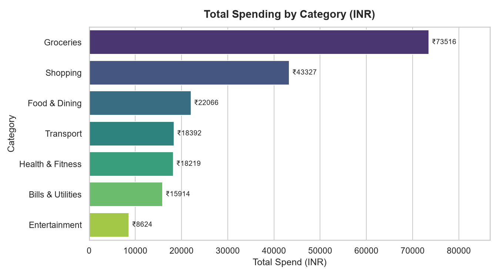
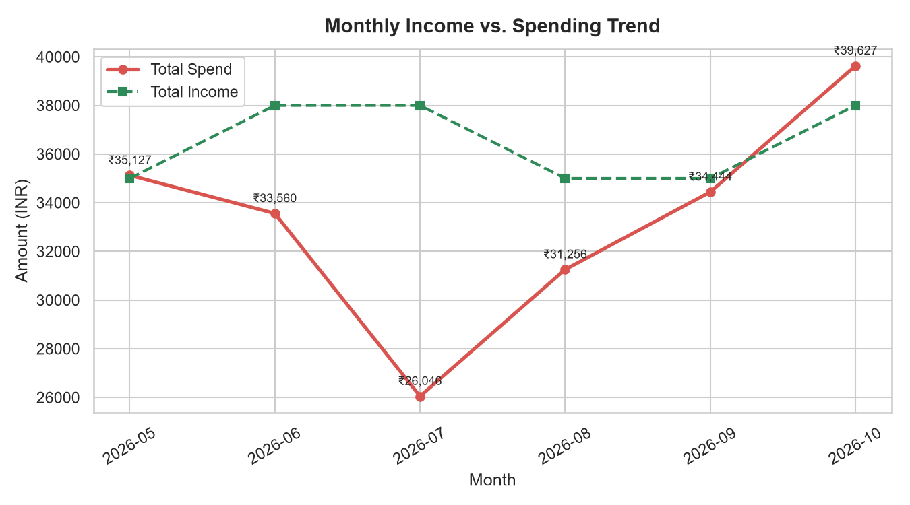
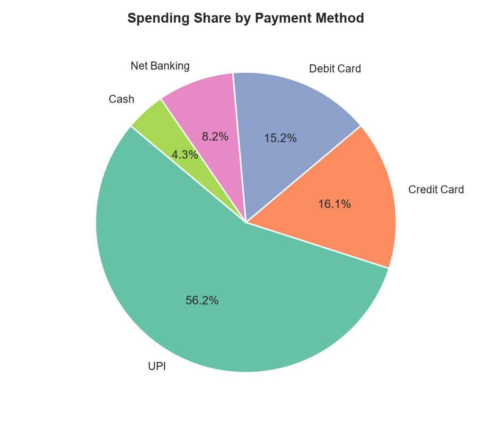
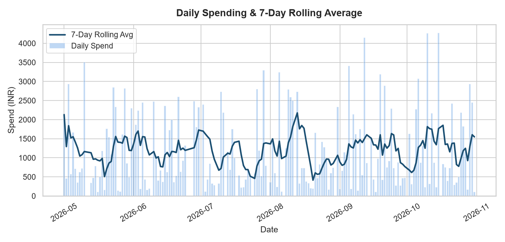

# Personal Expense Tracker with Data Visualization

A modular, industry-oriented Python personal finance analytics pipeline that ingests transaction CSVs, cleans and normalizes records, auto-categorizes expenses using regex rules, persists data in SQLite, checks monthly category budgets, generates publication-ready Matplotlib/Seaborn charts, exports CSV/TXT/Excel reports, and serves an interactive Streamlit dashboard.

## Problem Statement
Individuals, students, and freelancers often track expenses across disconnected UPI apps, bank statements, and cash notes without a unified view of where their money goes. Without structured categorization, trend analysis, and budget alerts, overspending goes unnoticed until month-end.

## Industry Relevance
This project mirrors real-world **Data Analyst**, **Python Developer**, **Business Analyst**, and **FinTech Automation** workflows:
- **ETL & Data Cleaning**: Handling inconsistent CSV schemas, malformed dates, whitespace, and duplicate rows.
- **Database Design**: Normalized SQLite schema (`categories`, `transactions`, `budgets`) with foreign keys and unique constraints.
- **Rule-Based Classification**: Regex merchant matching (extensible to Naive Bayes / scikit-learn).
- **KPI & Budget Analytics**: Savings rate, average daily spend, category share, and budget variance.
- **Data Storytelling & Reporting**: Automated PNG charts, multi-sheet Excel workbooks, and interactive Streamlit filtering.

## Key Features
- **Synthetic Data Generator**: Creates a realistic 6-month INR personal finance dataset (including intentional dirty rows to demonstrate cleaning).
- **Automated Cleaning & Deduplication**: Validates dates, coerces numeric amounts, strips whitespace, and prevents duplicate inserts.
- **Rule-Based Auto-Categorization**: Maps merchants (Swiggy, D-Mart, Uber, JioFiber, etc.) to structured categories.
- **SQLite Persistence**: Stores transactions, categories, and monthly budgets in `db/expenses.db`.
- **4 Core Visualizations**:
  - Category-wise Spending Bar Chart (`images/category_spending_bar.png`)
  - Monthly Income vs. Spending Line Chart (`images/monthly_spending_line.png`)
  - Payment Method Pie Chart (`images/payment_method_pie.png`)
  - Daily Spending & 7-Day Rolling Average (`images/daily_spending_trend.png`)
- **Automated Reports**: Exports `outputs/*.csv`, `reports/monthly_summary_report.txt`, and `reports/monthly_report.xlsx`.
- **Interactive Streamlit Dashboard**: Upload CSVs, filter by month/account, view KPIs, and monitor budget overruns (`src/app_streamlit.py`).

## Tech Stack
- **Language**: Python 3.11+
- **Data Processing**: `pandas`, `numpy`
- **Database**: `sqlite3`
- **Visualization**: `matplotlib`, `seaborn`
- **Dashboard**: `streamlit`
- **Reporting**: `openpyxl`, `xlsxwriter`
- **Testing**: `pytest`

## Folder Structure
```text
Personal-Expense-Tracker-Visualization/
├── data/               # Raw & synthetic CSV transaction datasets
├── db/                 # SQLite database (expenses.db)
├── notebooks/          # Jupyter notebook walkthrough
├── src/                # Modular Python source code
│   ├── models.py       # SQLite schema & initialization
│   ├── data_generator.py # Synthetic 6-month dataset generator
│   ├── ingest.py       # CSV loading, cleaning & upsert
│   ├── categorize.py   # Regex-based auto-categorization
│   ├── analyze.py      # KPIs, category, monthly & daily analytics
│   ├── budget.py       # Monthly budget limits & overspend alerts
│   ├── visualize.py    # Matplotlib & Seaborn chart generation
│   ├── report.py       # CSV, TXT & Excel report exporter
│   └── app_streamlit.py # Interactive Streamlit web dashboard
├── outputs/            # Aggregated CSV summary tables
├── images/             # Generated PNG charts
├── reports/            # Monthly TXT and Excel reports
├── docs/               # Complete 14-part guide & interview prep
├── tests/              # Unit tests
├── main.py             # End-to-end pipeline runner
├── requirements.txt    # Python dependencies
└── .gitignore          # Git ignore rules
```

## How to Run

### 1. Clone & Set Up Environment
```bash
git clone https://github.com/<your-username>/Personal-Expense-Tracker-Visualization.git
cd Personal-Expense-Tracker-Visualization

python -m venv venv
# Windows:
venv\Scripts\activate
# macOS / Linux:
source venv/bin/activate

pip install -r requirements.txt
```

### 2. Run the End-to-End Pipeline
```bash
python main.py
```

### 3. Launch the Streamlit Dashboard
```bash
streamlit run src/app_streamlit.py
```

## Sample Output
```text
=== SUMMARY INSIGHTS ===
Total Income             : INR 219,000.00
Total Spending           : INR 200,059.64
Net Savings              : INR 18,940.36 (8.7%)
Highest Spend Category   : Groceries (INR 73,516.28)
Average Daily Spending   : INR 1,087.28
Average Monthly Spending : INR 33,343.27
```

## Visual Outputs
| Category Spending | Monthly Trend |
| :---: | :---: |
|  |  |

| Payment Method Share | Daily Spending Trend |
| :---: | :---: |
|  |  |

## Learning Outcomes
- Designing normalized relational schemas in SQLite for financial transactions.
- Writing idempotent ETL pipelines with Pandas data cleaning and deduplication.
- Implementing rule-based text classification for transaction descriptions.
- Building executive-ready charts, Excel reports, and an interactive Streamlit dashboard.
